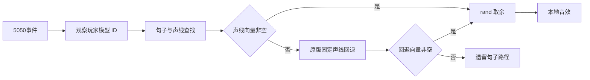

# 人物 J 菜单与语音独立复核

原版声线缺句会按固定表回退，单候选也会调用一次 `rand()`；旧候选的直接静音与跳过随机数不符合原指令。父代理已修正生产实现。本次实际客户端入口 1,350 项、原表组件 37 项通过；没有部署或游戏内听音验收。

## 原指令与修正

本地证据目录：`analysis/csol-model-20261017/character-audio/emotion-voice-review-20261103`（不随源码发布）。仅使用独立复制的 MP/HW/client PE 和本代理已有的独立 IDA 会话，没有打开原 samples IDB。PE 身份与逐块校验保存在 `verified-03.json`；原字符映射及 fallback 用 Unicorn 执行原指令，未调用游戏。

| 原地址 | 确认行为 | 候选影响 |
|---|---|---|
| MP `1140EFDA..1140EFE5` | menuselect case15 明确限制 `1 <= slot <= count`，第 5 项没有例外 | 菜单入口必须遵守 count；技能内部 action5 可独立调用 |
| MP `114D0300` | slot5 只省略缩放拒绝提示，随后仍返回拒绝 | 不能把这里理解为第 5 项放行 |
| client `02A3E730` | 按观察玩家模型 ID 查声线；普通 ID 再按 male 位 | 1,024 个模型/性别输入与候选匹配 |
| HW `37541310` + `37330660` | 声线名称到 ID | 70 个候选名称逐一执行原函数，全部匹配；没有替换比较函数 |
| SharedDataMgr v624 `37A5A620 -> 37541120` | 真正句子查找；先找句子，再取声线向量；空向量才走 fallback | 修复 `FindSentence`，非空专属语句保持优先 |
| HW `3753FBC0` | 固定 fallback 表，有些新声线保持原 ID，不是全部按性别回退 | 256 输入原指令与候选匹配 |
| HW `375412A7..375412D9` | 调 CRT `rand`，按向量长度取余，包括长度 1 | 修复单候选时随机数推进；import `38010134` 已确认为 CRT rand |
| client `02A41BAD -> 02AB37D0 -> 02AB4DD0` | 5050 传本地玩家索引、零空间标志；成功句子音量 1、声道 0 | 本地音效路径，没有从此事件发服务器消息 |
| engine `3782FC60` | 原引擎表 `382FEBC0+23C`，将音效送本地动态音效 `378F79C0` | 支持本地播放结论，不声称服务器广播 |

旧报告中的 `37541F00 / 37A5BD30` 是将一句的各声线资源预缓存，不是随机句子查找；真正查找函数如上。

fallback 完整表：

- 到 woman(1)：4、5、6、8、10、11、12、13、17、21、22、24、25、26、31、32、34、35、37、38、43、45、46、47、49、50、51、54、55、56、57、58、60、61、62、63、64、66、69。
- 到 man(0)：7、9、14、15、16、18、23、33、36、44、48、59、67。
- 68 到 zombie_woman(3)。其余保持输入 ID。仅当目标 ID 不同才递归同一句；最终仍缺则返回空。

## 静音边界

原客户端在 JSON 查找最终为空时，仍尝试遗留 `!sentence` 路径：从 `%!` 中的 `!` 开始复制，遇到字符不大于空格或不小于 `z` 停止；声线 1/2/3/4/5/6 分别追加 `_W/_ZB/_ZW/_CW/_W_JIN/_CSO2`，其余不追加，以音量 1、声道 2 本地播放。完全没有 `%!` 的选项则直接交原音效接口，pitch 100。

当前 common `sound/sentences.txt` 没有 MRAD_EMOTION 条目。父明确保留当前资源缺句时无声，不伪造遗留句子或替换音效；这属于移植边界，不能把静音称为原版没有 legacy 分支。已有 JSON 指向但实际缺失的两个 dance WAV 不在本次修复中补造。本次也没有重新搜索已由用户取消的青龙重击音效。

## 验证与交接

| 范围 | 结果 | 证据 |
|---|---|---|
| 实际 `emotion_voice.cpp` 独立 TU、SDK fixture TU、链接 | 全部 exit 0 | `build/csol-character-emotion-20261103/client-sdk-02/result.json` |
| 实际5050入口、角色切换、空向量回退、专属优先、模板存在性、同图Reset/换图、异常输入、单项/多项CRT随机数 | 1,350 检查，0 失败，含 1,280 项原指令映射对照 | 同目录 `test.log` |
| 原 CSV/titles/JSON 组件 | 37 检查，0 失败，60 个 buffclass 声线交叉检查 | `build/csol-character-emotion-20261103/unit-review-01/result.json`、`step-2.log` |
| 初次夹具失败 | 回调参数错误使用 char*，SDK 是 const char*；生产 TU 已通过。只修夹具签名，旧证据保留 | `client-sdk-01` |
| 逐次输入保持 | frozen 和生产输入保持；无未知包含项 | 两个成功结果 JSON |

受验生产 `character_voice.hpp` SHA-256 `3c35723688542ef938836d1f1f8a656ba7b058d22ecffac9a36c768faa4e2195`；`emotion_voice.cpp` SHA-256 `1646d70bbe659217501711d8c7d3584b0883e0159baafbedffcfde44c2dd03b8`。本代理只新增测试和窄报告，将旧模板测试改为直接检查 map 是否含专属条目，避免用带 fallback 的查询误判“模板未展开”。生产由父代理修改。

剩余：完整 DLL 合并构建、真实 J 菜单开关/取消/人物互斥、客户端下载和听音、旁观及多人行为；不能将本次组件结果当作完整语音或全部人物技能交付。共享四文档和发布由父代理处理。
